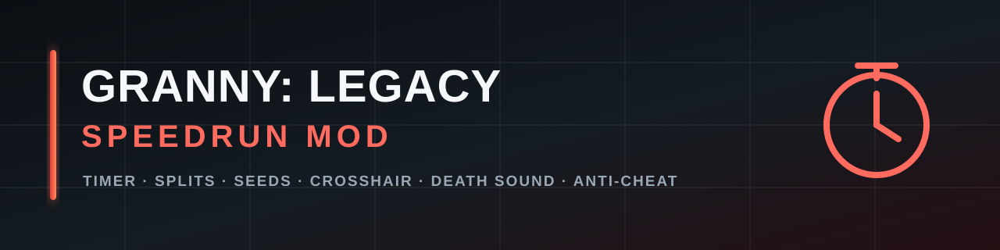

<p align="center">
  
</p>

# Granny: Legacy Speedrun Mod

[English](README.md) | [Русский](README.ru.md) | [Português](README.pt.md)

[](https://github.com/T300850/GrannyLegacySpeedrunMod/releases)
[](https://store.steampowered.com/search/?term=Granny+Legacy)
[](https://melonwiki.xyz/)
[](#)

**Speedrun timer, splits, seed control, custom crosshair, death sound and anti-cheat for Granny: Legacy.**

Made by [TL12 Mods](https://t.me/TL12Mods) · [speedrun.com](https://www.speedrun.com/users/t300850) · [GitHub](https://github.com/T300850)

> **Download:** [GitHub Releases](https://github.com/T300850/GrannyLegacySpeedrunMod/releases) · **Changelog:** [CHANGELOG.md](CHANGELOG.md)

---

## Features

- **Run timer and splits** — automatic timer, best time, PB comparison, split overlay and a separate results screen.
- **Seed control** — set a seed, save favourite seeds, mark seeds as Extras, use the current seed and copy the seed used by the game.
- **Spawn points** — choose and remember Granny/Grandpa spawn points separately for each game version.
- **Crosshair** — native game dot tint, custom cross/circle crosshair, colour and size settings.
- **Custom death sound** — WAV, MP3, OGG and AIFF support, with a Test button and a per-run cooldown.
- **Playhouse cog splits** — automatic splits for the Playhouse puzzle.
- **Version-aware wire/chain splits** — 1.0–1.1 (2 wires), 1.2–1.7 (3 wires), 1.8+ (4 steps incl. chain cutter).
- **Anti-cheat** — detects synthetic input, autoclickers, macros, speed/time manipulation, pickup distance and hand reach. Writes a local report and shows a warning badge.
- **Visuals and performance** — post-processing toggles, FPS limit, experimental 5–15 FPS limiter and a keystrokes overlay.
- **Quality of life** — skip wake-up cutscene, mouse side-button swap, quick restart, go-to-menu bind, copy results.
- **Languages** — Russian, English and Portuguese (RU / EN / PT).

The mod was tested with game versions **1.7.9** and **1.8.8**.

---

## Requirements

- Windows PC with **Granny: Legacy**.
- **MelonLoader 0.7.x** (0.7.3 or newer recommended).
- For the death sound: **NAudio** and **NVorbis** libraries in the `UserLibs` folder.

---

## Installation

1. Install **MelonLoader** into the game folder and launch the game once so MelonLoader generates its folders.
2. Download the latest release archive. It already contains the `Mods` and `UserLibs` folders with the correct files.
3. Copy `GrannyLegacySpeedrunMod.dll` into:

   ```text
   Granny_Legacy/Mods/
   ```

4. Copy **all** `NAudio*.dll` files and `NVorbis*.dll` into:

   ```text
   Granny_Legacy/UserLibs/
   ```

   Required for the custom death sound. Copy every `NAudio*.dll` from the release archive — do not copy only `NAudio.dll`.

5. Start the game. Open the mod menu with **F2**.

Final layout:

```text
Granny_Legacy/
├─ Mods/
│  └─ GrannyLegacySpeedrunMod.dll
├─ UserLibs/
│  ├─ NAudio.dll
│  ├─ NAudio.Asio.dll
│  ├─ NAudio.Core.dll
│  ├─ NAudio.Midi.dll
│  ├─ NAudio.Vorbis.dll
│  ├─ NAudio.Wasapi.dll
│  ├─ NAudio.WinMM.dll
│  └─ NVorbis.dll
└─ UserData/
   ├─ GrannyLegacySpeedrunMod_Config.txt
   └─ GrannyLegacySpeedrunMod_AntiCheat.txt
```

> `UserData` is created after the first launch. Keep the game and MelonLoader folders outside protected system paths, or run the game with the permissions needed to write there.

---

## Controls

| Key | Action |
| --- | --- |
| **F2** | Open/close the mod settings (always works) |
| **F1** | Open/close the debug overlay |
| **F5** | Restart the current run (default; can be changed) |
| `menuKey` | Open the mod overlay (disabled by default) |
| `exitKey` | Return to the main menu (disabled by default) |
| `experimentalFpsKey` | Toggle experimental FPS mode (default `F4`) |

Binds are configured on the **Main** tab of the mod menu. The menu itself is always available on **F2**, even if the overlay bind is set to `None`.

Useful debug keys while the debug overlay is open: **L** toggles mod logs, **C** copies the last results.

---

## Death sound

1. Open **F2 → Visuals**.
2. Click **Choose file...** and select a `.wav`, `.mp3`, `.ogg`, `.aiff` or `.aif` file.
3. Wait for the green status line: the file is decoded asynchronously.
4. Click **Test** to play it.
5. In a run, the sound plays when the player dies. It has a cooldown so it cannot overlap itself.

If the status line is red or the test button does nothing:

- make sure **all** `NAudio*.dll` and `NVorbis*.dll` files are in `UserLibs`;
- check `MelonLoader/Latest.log` for the exact error;
- try a short WAV file to rule out a codec problem.

The rest of the mod works without NAudio; only the custom death sound depends on it.

---

## Seeds

- The **Seeds** tab lets you type a seed, apply it, save it and mark it as Extras.
- **Random** applies a random seed.
- The seed shown in the results/stats is the seed used by the game; if the game does not expose it, the mod falls back to `PlayerPrefs.GameSeed`.
- Seed lists are stored in `UserData/GrannyLegacySpeedrunMod_Seeds.txt` (or the seed file configured by the mod).
- Save a seed before changing the in-game version or reinstalling the game.

---

## Anti-cheat

The anti-cheat runs locally. It does **not** send any data over the network.

It checks for:

- synthetic input (`SendInput`) and input-injection tools;
- autoclickers and very fast click patterns;
- repeated macros;
- speedhack / time-scale changes;
- suspicious pickup distance;
- hand reach beyond the normal range.

A local report is written to:

```text
Granny_Legacy/UserData/GrannyLegacySpeedrunMod_AntiCheat.txt
```

The **Anti-cheat** tab shows current findings and has a clear button. False positives are possible with accessibility tools, macros, remote-play software and automation; clear them before a run if you are not cheating.

### Log filtering

In the debug overlay (**F1**), the **Logs** button switches between:

- **Logs: all** — normal mod logs;
- **Logs: SUS only** — hides routine messages but keeps anti-cheat suspicion and cheat warnings.

This setting is saved as `hideMelonLogs` in the config file.

---

## Configuration

The config is stored at:

```text
Granny_Legacy/UserData/GrannyLegacySpeedrunMod_Config.txt
```

Main keys:

```ini
restartKey=F5
menuKey=None
exitKey=None
experimentalFpsKey=F4
language=ru
hideMelonLogs=0
```

- `language` accepts `ru`, `en` or `pt`.
- Use `None` to disable a bind.
- Delete the file to regenerate defaults; PlayerPrefs-based settings (theme, seed history, etc.) may remain.

---

## Experimental FPS limiter

The **Experimental FPS (5–15)** option is intended for testing and cinematic runs. It changes the game's frame timing and **must not be used in official speedruns** unless the community rules explicitly allow it. The normal FPS limit (30–240 / unlimited) is safe for regular play.

---

## Source code

The source code is kept private to protect the anti-cheat signatures. Official builds are published in [Releases](https://github.com/T300850/GrannyLegacySpeedrunMod/releases).

---

## Troubleshooting

**The mod does not load.**  
Check that MelonLoader is installed for the correct game executable and inspect `MelonLoader/Latest.log`. The log must show `GrannyLegacySpeedrunMod` in the loaded mods list.

**F2 does nothing.**  
Make sure the game window is focused. F2 is hardcoded and does not depend on the overlay bind.

**The death sound button does nothing.**  
Install all NAudio/NVorbis DLLs in `UserLibs`, then restart the game. Check the status line and `Latest.log`.

**The native crosshair stays white.**  
Select **Crosshair → Game** and a non-white colour. On 1.7.9 the game rewrites the native crosshair colour in its own `Update`; the mod re-applies the tint every frame. If it still fails, check the log for the crosshair diagnostic line.

**The seed in the results is wrong.**  
Start the run after applying the seed and check the `[seed]` lines in `Latest.log`. The mod captures the seed after `GeneratePlacement` and falls back to `PlayerPrefs.GameSeed` when the game reports zero.

**Anti-cheat shows SUS after using remote play or a macro.**  
Clear the findings before the run. Synthetic input from automation is intentionally flagged.

---

## Credits

- **TL12 Mods** — mod author.
- **MelonLoader** and **Harmony** — mod loading and patching.
- **NAudio** and **NVorbis** — audio decoding.
- The Granny: Legacy speedrunning community — testing, routes and feedback.

---

## Disclaimer

This is an unofficial fan-made mod. It is not affiliated with DVloper or the developers of Granny: Legacy. Use it at your own risk, back up your saves and check the current speedrun community rules before submitting a run.
